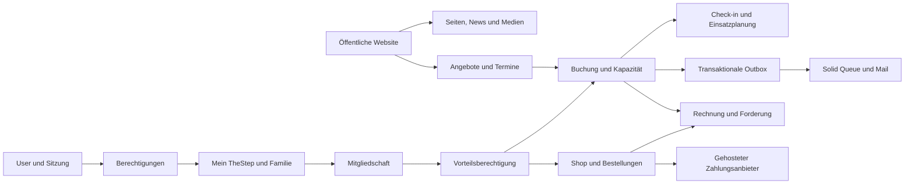
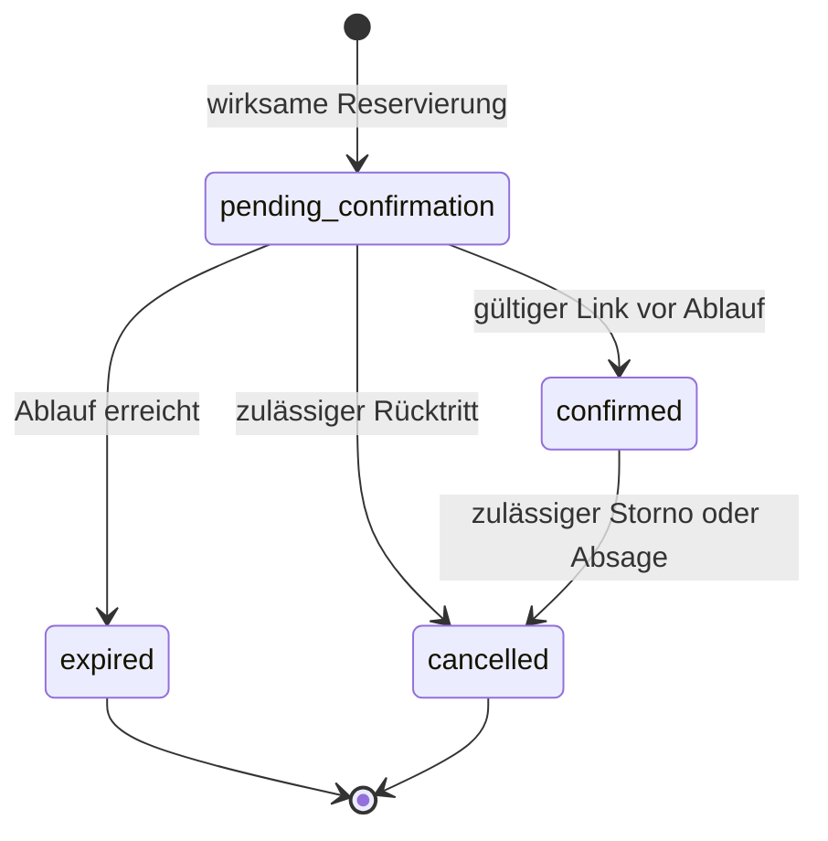

# Architektur, Daten und Schnittstellen

## Technischer Rahmen aus „TheStep Verein“

Die folgenden Werte stammen aus dem sauberen lokalen Referenzstand `b82d07f387b35836b273800b3d7fd169b6a1a145`; sie sind kein ungeprüfter Vorschlag für jeweils neueste Versionen.

| Bereich | Übernommener Rahmen |
|---|---|
| Runtime | Ruby 4.0.6 über mise, .ruby-version und .mise.toml |
| Framework | Rails 8.1.3.1; Gemfile ~> 8.1.3 mit Lockfile |
| Datenbank | SQLite, Gem sqlite3 2.9.6; Primary, Queue und Cache getrennt |
| Web/Assets | Puma, Thruster, Propshaft, ERB und eigene CSS-Tokens |
| Interaktion | importmap-rails 2.2.3, turbo-rails 2.0.23, stimulus-rails 1.3.4 |
| Redaktion | Action Text und Lexxy ~> 0.9.23 |
| Dateien | Active Storage, image_processing und libvips; persistente Originale/Varianten |
| Jobs/Cache | Solid Queue und Solid Cache; überwachte wiederkehrende Jobs |
| Authentifizierung | bcrypt/has_secure_password, serverseitige Sessions und zweckgebundene Tokens |
| Deployment | Docker, GHCR, Kamal 2.12.0 und Hetzner; eigene isolierte Zielumgebung |
| Infrastruktur | Terraform 1.15.8 ist im Referenzprojekt gepinnt; neue Infrastruktur nur bei entsprechendem Umsetzungsauftrag |
| Qualität | Minitest, Capybara/Selenium, RuboCop Rails Omakase, Brakeman, Bundler Audit und Bullet |

Es gibt keinen Anlass für React, Next.js, Microservices, Redis oder einen spontanen Datenbankwechsel. Falls die bestätigten Handels-/Lastanforderungen später eine Änderung verlangen, wird diese mit Messnachweis als Architekturentscheidung behandelt. Das neue Repository startet als Planung und enthält noch keine installierte Rails-Anwendung.

## Fachliche Grenzen

Die Darstellung ist ein Zielbild innerhalb eines Monolithen. Externe Adapter werden nur für entschiedene Dienste benötigt. Rails-Konventionen und überschaubare Klassen sind die Ausgangsbasis; ein universelles CMS oder frei definierbarer Formularbaukasten wird nicht eingeplant.

## Datenmodell und unverzichtbare Regeln

| Fachobjekt | Beziehungen und Invarianten |
|---|---|
| User / Session | Zugang, Rolle, Zuständigkeiten, optionales Teamprofil; letzter aktiver Admin geschützt |
| Participant / GuardianRelationship | Teilnehmer unabhängig vom Login; explizit bestätigte, widerrufbare Familienbeziehung |
| Membership / Application | Antrag und aktive Mitgliedschaft getrennt; gültige Art, Beginn/Ende, Ordnungsversion und Mitgliedsnummer |
| CourseOffering / CourseOccurrence | Typisierte Angebotsregeln und einzelne Termine; Serienausnahmen ändern keine historischen Zusagen still |
| Booking / BookingParticipant | R1 eine teilnehmende Person je Buchung; ein Familienportal kann mehrere getrennte Buchungen bündeln |
| CapacityReservation | Wirksame Reservierungen zählen bis Ablauf; Workshop/Camp als explizite Einheit, Block als atomarer Satz von Terminen |
| WaitlistEntry / WaitlistOffer | Bestätigter Rang, höchstens ein wirksames Angebot je freigegebenem Platz, befristete Annahme |
| BookingAction / Attendance | Append-only Änderungshistorie im nötigen Umfang; Anwesenheit je Termin/Tag; begrenzte Coachrechte |
| NotificationOutbox | Eindeutiges fachliches Ereignis, Wiederholung und minimaler Versandstatus; keine Tokens im Audit |
| WebPage / CommunityContent / Media | Veröffentlichungsstand, Version, Rechtebeleg und abgeleitete Varianten; öffentliche Filter am Ursprung |
| Invoice / CreditNote / PaymentEntry | Ganze Centbeträge, unveränderliche ausgestellte Belege; Zahlung, Forderung und Buchungsstatus getrennt |
| CoachAssignment / TimeEntry | Aktiver Einsatz und Zeitfenster für Kursdaten; erfasste Zeit mit getrenntem Einreichungs-/Freigabestatus |
| MaterialItem / MaterialMovement | Verfügbar, ausgegeben, defekt und Wartung; keine negative verfügbare Menge |
| ProductVariant / Order / StockReservation | Serverseitiger Preis-Snapshot, atomare Bestandsreservierung und eindeutiger Checkoutvorgang |
| Voucher / VoucherEntry | Nicht erratbarer Code, unveränderliche Bewegungen und atomarer Restwert |

Die Namen neuer Modelle sind Planvorschläge. BAS-01 gleicht sie mit bestehenden Kurs-, Buchungs- und Anwesenheitsklassen ab, damit keine parallelen Fachmodelle entstehen. Pflichtfelder, Indizes und Datenbankregeln werden in der jeweiligen Story konkretisiert. Bestehende Migrationshistorie und Reset-Werkzeuge werden nicht blind übernommen.

## Zustände und Transaktionen

Wartelistenstatus und Zahlungsstatus sind eigene Zustandsmaschinen. Eine abgelaufene Reservierung kann nicht nachträglich ohne neue Kapazitätsprüfung bestätigt werden. Beim Umbuchen werden Ursprungsfreigabe und Zielbelegung gemeinsam entschieden. Bei Camp-/Blockbuchungen sind alle nötigen Kapazitäten Teil einer Transaktion.

SQLite besitzt einen gleichzeitigen Schreiber. Kapazität wird daher nicht durch einen vorherigen COUNT im Controller oder PostgreSQL-spezifisches Zeilensperren abgesichert. Nötig sind ein für SQLite geprüfter Schreibtransaktionsablauf, eindeutige Datenbankregeln und begrenzte Wiederholung bei Schreibkonflikten. Die letzte-Platz-Prüfung läuft gegen dateibasiertes SQLite mit getrennten Verbindungen und Prozessen. [Primärquelle: SQLite-Transaktionen](https://www.sqlite.org/lang_transaction.html).

Der fachliche Übergang und sein Outboxereignis liegen in derselben Primary-Datenbanktransaktion. Die Queue liegt separat; eine alleinige Job-Einplanung über diese Datenbankgrenze bietet hier keinen Nachweis atomarer Zustellung. Jobs dürfen erneut laufen. E-Mail-Transport kann trotz Ereignis-Deduplizierung im Fehlerfall doppelt zugestellt werden; Links und Folgewirkungen müssen das schadlos vertragen. [Primärquelle: Rails Active Job](https://guides.rubyonrails.org/active_job_basics.html).

## Berechtigungsrahmen

| Rolle/Beziehung | Erlaubter Kontext | Ausschlüsse |
|---|---|---|
| Gast | Öffentliche Inhalte, eigene sichere Buchungslinks | Keine Teilnehmerlisten oder Mitgliederdaten |
| Mitglied | Eigenes Profil, eigene Buchungen, Vorteile und freigegebene Dokumente | Keine fremden Belege oder internen Personaldaten |
| Erziehungsberechtigte | Explizit freigegebene Beziehungen und Buchungen | Namensgleichheit oder Mailadresse beweist keine Beziehung |
| Coach | Zugeordnete Termine und notwendige Teilnehmerdaten, vorgeschlagen 7 Tage vorher bis 7 Tage nachher | Keine generellen Redaktionsrechte; keine Finanz-/Mitgliederdaten |
| Mitarbeiter | Eigene Einsätze, Zeiten und interne freigegebene Informationen | Keine automatische Freigabe eigener Zeiten |
| Editor | Freigegebene redaktionelle und operative Verwaltungsfunktionen | Keine Konten-/Rollenvergabe ohne separate Berechtigung |
| Kasse / Shopteam | Notwendige Finanz- beziehungsweise Bestelldaten | Keine sensiblen Kinderangaben aus Kursbetrieb |
| Admin | Administration entsprechend freigegebener Rollenmatrix | Nicht vom letzten-Admin-Schutz oder Audit ausgenommen |

Mitgliedschaft, Kasse und Shopzugriff erweitern die Referenz bewusst; ihre genaue Rechtevergabe wird mit den zuständigen Rollen abgenommen. Listen, Details, Downloads, Exporte und Aktionen prüfen dieselbe fachliche Berechtigung je Request.

## Schnittstellen und Fehlermodell

- SMTP: dauerhafte Outbox, verzögerte Wiederholung und manuelle berechtigte Wiederholung. Keine fachliche Zusage allein durch erfolgreichen E-Mail-Versand.
- Zahlung: gehosteter Anbieter, signierte Ereignisse, idempotente Verarbeitung, Betrags-/Währungsabgleich und getrennte Bestellwirkung. Bei spätem Erfolg nach Ablauf wird ein dokumentierter Klärungs-/Erstattungspfad benötigt.
- Medien: Active Storage ist keine pauschal öffentliche Ablage. Private Dokumente nutzen autorisierte Downloads; ein öffentlicher Variantlink darf einen Rechtewiderruf nicht dauerhaft umgehen.
- Karten, Videos, Social Feed: eigenständige freiwillige Zwecke, server-/clientseitige Ladegrenzen und brauchbarer Fallback.
- Feiertage: versionierte amtliche BW-Daten mit Quelle und geprüftem Aktualisierungsverfahren.
- Vereins-App: erst nach Wahl eines konkreten Systems mit führender Datenquelle und Vertragstests; keine vorauseilende allgemeine API.
