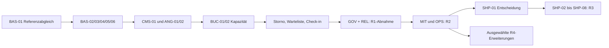

# Roadmap und Backlogsteuerung

## Releasefolge und Abnahmepunkte

Die Releases sind fachliche Pakete mit klaren Eintritts- und Austrittsbedingungen. Sie haben bewusst noch keine erfundenen Termine oder persönlich zugewiesenen Kapazitäten. Story Points sind grobe relative Größen und werden nach BAS-01 und vor Umsetzung je Story überprüft. Ein Punkt ist kein Arbeitstag. Ein belastbarer Kalenderforecast folgt erst aus Teamverfügbarkeit und mindestens zwei gemessenen Umsetzungstakten.

| Release | Stories | Punktehypothese | Ergebnis und Freigabepunkt |
|---|---:|---:|---|
| R0 – Fundament und verbindliche Entscheidungen | 6 | 34 | Referenzabgleich, Rails-Basis, Berechtigungen, Design und lauffähige isolierte Staging-Umgebung. Kein öffentlicher Buchungsstart. |
| R1 – Website und Buchungsbetrieb | 45 | 263 | Öffentliche Informationen, Redaktion, Angebote, sichere Gastbuchung, Kapazität, Warteliste und operativer Kursbetrieb. Zahlung zunächst vor Ort; kein Shop. |
| R2 – Verein und Team | 21 | 122 | Mitgliedschaft, Familienportal, Rechnungsläufe, Mitarbeiterzeiten, Einsatzplanung und interne Zusammenarbeit. |
| R3 – Shop und Gutscheine | 9 | 62 | Freigegebenes Handelsmodell, Produktkatalog, Mitgliederpreise, Checkout, Bestellabwicklung und Gutscheine. |
| R4 – Optionale Erweiterungen | 10 | 57 | Separat priorisierbare Extras aus IMG_1143 und ergänzenden Medienanforderungen. Kein Blocker für R1–R3. |

R0 ist ein technischer Fundament-Meilenstein. R1 öffnet erst, wenn Buchung, Mail, Berechtigungen, Inhalte und Wiederherstellung zusammen geprüft wurden. R2 erweitert die Datenklassen und benötigt eigene Aufnahme-/Beitrags-/Personalabnahmen. R3 startet erst mit entschiedenem Händler-/Zahlungs-/Belegmodell. R4 enthält optionale Einzelfunktionen und wird nach Nutzen neu priorisiert.

## Empfohlene Arbeitsfolge

1. BAS-01 klärt realen Bestand und Wiederverwendung; D01/D02 werden dokumentiert.
2. BAS-02 bis BAS-06 schaffen Runtime, Zugang, Design und Staging. GOV-01 wird früh umgesetzt, damit Einwilligungen nicht nachgerüstet werden.
3. CMS-01/CMS-03 sowie ANG-01/ANG-02 schaffen Inhalte, Rechte, Angebote und Termine. WEB-02/WEB-07/GOV-02 bereiten die tatsächlichen Informationsinhalte vor.
4. BUC-01/BUC-02 und ANG-07 sichern den Kernprozess; erst danach werden freie Plätze, Preis-Snapshots, E-Mails und reguläre Kursblöcke integriert.
5. BUC-05 bis BUC-10 und EVT-01/EVT-02 vervollständigen Storno, Nachrücken, Anwesenheit, Events und Kommunikation. WEB-01 wird mit echten freigegebenen Daten fertiggestellt.
6. GOV-03/GOV-05/GOV-06 und REL-01 bis REL-04 schließen R1 mit echten Fehler-, Parallelitäts-, Inhalts- und Restoreprüfungen ab.
7. R2 setzt zuerst gültige Mitgliedschaftsordnung und Familiennachweis um, anschließend Status/Vorteile, Beiträge/Belege und Mitarbeiterabläufe. R1-Zahlungsvermerk ist bewusst bereits vorher möglich.
8. R3 beginnt mit SHP-01. Produktkatalog, Vorteilsermittlung und Bestandsregeln gehen dem Checkout voraus; Versand/Retoure, Gutschein und Rechts-/Belegabnahme folgen.
9. Optionale Stories aus R4 werden einzeln anhand von Nutzen, laufenden Kosten und Verantwortlichkeit aktiviert.

Der Graph zeigt Hauptstränge. Verbindlich sind die einzelnen Story-Abhängigkeiten in `backlog.json` und den Issues. Daten- und Designarbeiten können nach geklärten gemeinsamen Schnittstellen parallel erfolgen; die Reihenfolge ihrer Abnahme bleibt bestehen.

## GitHub-Struktur

- Projekt: **The Step**, bestehendes Projekt Nr. 4; Repository als Standardrepository.
- 13 Epic-Issues mit fachlichem Ziel und verlinkten Stories. Epics können mehrere Releases umfassen und erhalten daher keinen irreführenden Abschlussmeilenstein.
- Jede Story ist ein eigenes Repository-Issue mit stabiler ID, sechs konkreten AKs, Prüffall, Abhängigkeiten, technischem Kontext und Umsetzungscheckliste.
- Milestones R0 bis R4 bilden Releases ab. Labels kennzeichnen Typ, Bereich und Priorität; `entscheidung-offen` kennzeichnet noch nötige fachliche Klärung.
- P0 bedeutet notwendiges Freigabekriterium des jeweiligen Releases, P1 ergänzender Nutzen innerhalb des Releases, P2 optionale spätere Funktion. P0 in R3 ist keine Aufforderung, vor R1 einen Shop zu bauen.
- Todo bedeutet geplant. In Progress erfordert begonnene Umsetzung und geklärte Voraussetzungen. Done erfordert AK-Nachweise und fachliche Abnahme. Die Planung selbst setzt keine Produktstory auf Done.
- Keine automatische Zuweisung an eine einzelne Person: Verantwortungsrollen sind vorgeschlagen, personelle Zusagen liegen nicht vor.

Die Roadmapansicht verwendet Milestones statt erfundener Enddaten. Ein Board gruppiert nach Status; eine Tabelle dient dem Filtern nach Label und Milestone. GitHub-Issue-Links und lokale Storydateien beschreiben denselben Planungsstand; nach Umsetzung sind die Issues der führende Status.

## Ready und Änderungssteuerung

Eine Story ist bereit, wenn Vorgänger implementiert oder benötigte Schnittstellen explizit verfügbar sind, offene Entscheidungen für ihren Umfang dokumentiert wurden, AKs verständlich sind, Testdaten bereitstehen und eine abnehmende Rolle benannt ist. Große 13-Punkte-Stories werden vor Umsetzung bei Bedarf in unabhängig überprüfbare Teilstories geteilt, ohne AKs zu verlieren.

Neue Wünsche erhalten eine eigene Story oder eine nachvollziehbare Änderung an Umfang/AKs und Abhängigkeiten. Vorhandene Kriterien werden nicht still entfernt. Das öffentliche Board enthält keine echten Teilnehmer-, Bank-, Personal- oder vertraulichen Falldaten. Ein geschlossener Planungsauftrag ist keine pauschale Genehmigung für Produktivdeployments oder kostenpflichtige Anbieter.
